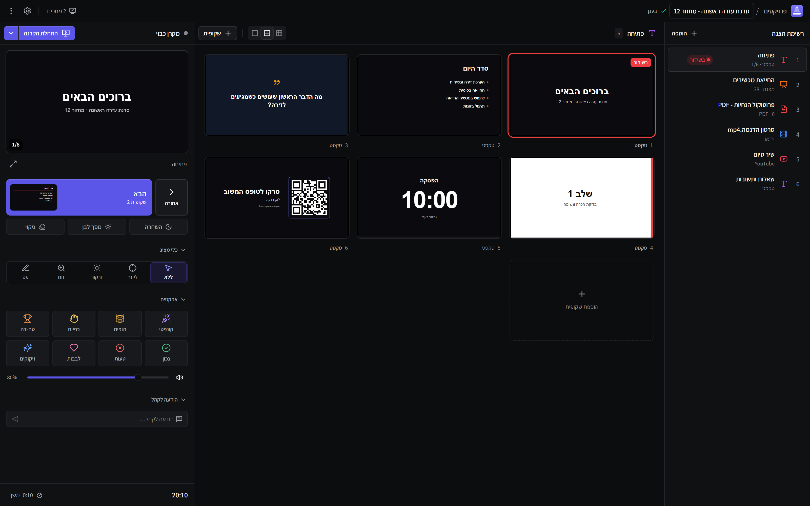

<p align="center">
  
</p>

<h1 align="center">Bima</h1>

<p align="center">
  Presentation and projection software for lectures and workshops.<br>
  The audience sees the slide. You see everything.
</p>

<p align="center">
  <a href="https://github.com/Guy1432/bima/releases/latest"></a>
  <a href="https://github.com/Guy1432/bima/actions/workflows/ci.yml"></a>
  
  <a href="LICENSE"></a>
</p>

<p align="center">
  <a href="#download"><b>Download</b></a> · <a href="#עברית">עברית</a>
</p>

<p align="center">
  
</p>

Bima runs a show on two screens: a clean full-screen output for the room, and an operator view with what's live, what comes next, and every control. The interface is in Hebrew, right to left.

## Features

- **One run-of-show** for PowerPoint (with its embedded and trimmed videos), PDF, video files, YouTube, images and designed text slides.
- **Always know what's next.** Edit slides privately; the audience sees them only when you put them on air.
- **Clicker-first.** Next, previous, blank screen, pause and resume video.
- **Presenter tools.** Laser, spotlight, zoom and drawing on screen; zoom and pan inside documents.
- **Built-in editing.** Text slides, drawing and markup on existing slides, video trimming.
- **Sync and export.** The same projects on all your computers, and export to PDF or PowerPoint.

## Download

Get the installer from the [latest release](https://github.com/Guy1432/bima/releases/latest). Updates install from inside the app.

| System | File |
| --- | --- |
| Windows 10 or 11 (64-bit) | `Bima_<version>_x64-setup.exe` |
| macOS 11 or later (Apple silicon and Intel) | `Bima_<version>_universal.dmg` |

**First launch**

- **Windows:** if you see "Windows protected your PC", click *More info*, then *Run anyway*.
- **macOS:** Bima isn't notarized by Apple yet. Right-click the app and choose *Open*. On macOS 15 and later, go to *System Settings → Privacy & Security* and click *Open Anyway*.

Importing PowerPoint files needs Microsoft PowerPoint (Windows) or [LibreOffice](https://www.libreoffice.org/) (Windows and macOS).

## Building from source

You need [Node.js](https://nodejs.org/) 22, [Rust](https://rustup.rs/) and the [Tauri prerequisites](https://v2.tauri.app/start/prerequisites/) for your system.

```sh
npm ci
npm run tauri dev     # run the app
npm run tauri build   # build an installer
```

| Folder | What's inside |
| --- | --- |
| `src/` | The interface: React and TypeScript, for the operator and audience windows |
| `src-tauri/` | Rust: windows and screens, media import, PowerPoint conversion, cloud sync |
| `cloud/worker/` | Cloudflare Worker that stores media for Bima Cloud |

Bima Cloud talks to the project's own Supabase and Cloudflare services. If you run your own build, point `SUPABASE_URL`, `SUPABASE_KEY` and `MEDIA_URL` in `src-tauri/src/cloud.rs` to yours.

**Releases:** `npm run release -- 0.8.0 "change · another change"` tags a version. GitHub Actions then builds and signs Windows and macOS and publishes the release.

## License

[MIT](LICENSE)

---

<div dir="rtl">

## עברית

בימה היא תוכנת הקרנה להרצאות וסדנאות. הקהל רואה את השקופית במסך מלא, ואתה רואה מסך שליטה עם מה שבשידור, מה הבא וכל הכלים.

### מה יש בה

- **רשימת הצגה אחת**: PowerPoint (כולל הסרטונים והחיתוכים שלהם), PDF, וידאו, YouTube, תמונות ושקופיות טקסט.
- **שליטה**: מה בשידור, מה בלחיצה הבאה, ועריכה שהקהל לא רואה עד שמקרינים.
- **קליקר**: הבא, הקודם, השחרה, ועצירה והמשך של סרטון.
- **כלי מציג**: לייזר, זרקור, זום וציור על המסך, וזום וגלילה במסמכים.
- **עריכה**: שקופיות טקסט, ציור וסימון על שקופיות קיימות, חיתוך סרטונים.
- **סנכרון וייצוא**: אותם פרויקטים בכל המחשבים שלך, וייצוא ל-PDF ול-PowerPoint.

### הורדה

מורידים מ[הגרסה האחרונה](https://github.com/Guy1432/bima/releases/latest). עדכונים מגיעים מתוך התוכנה.

- **ל-Windows** (10 או 11, ‏64 ביט): הקובץ שנגמר ב-`x64-setup.exe`.
- **למק** (macOS 11 ומעלה): הקובץ שנגמר ב-`universal.dmg`.

**בפתיחה הראשונה**

- **ב-Windows**: אם מופיעה ההודעה `Windows protected your PC`, לוחצים על `More info` ואז על `Run anyway`.
- **במק**: לוחצים על התוכנה במקש ימני ובוחרים `Open`. מ-macOS 15 ומעלה: הגדרות מערכת ← פרטיות ואבטחה ← `Open Anyway`.

ייבוא מצגות PowerPoint דורש את PowerPoint (ב-Windows) או את LibreOffice (ב-Windows ובמק).

</div>
