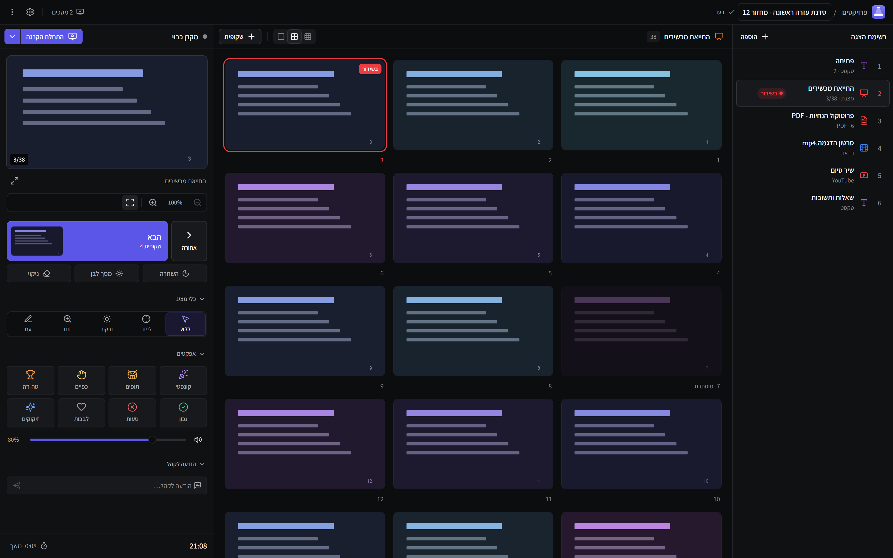

  

<h1 align="center" dir="rtl">בימה</h1>

  תוכנת הקרנה להרצאות וסדנאות. הקהל רואה את השקופית, ואתה רואה הכול.

  <a href="https://github.com/Guy1432/bima-releases/releases/latest"><b>הורדה ל-Windows</b></a>

 

  

## מה יש בה

- **רשימת הצגה אחת**: PowerPoint (כולל הסרטונים והחיתוכים שלהם), PDF, וידאו, YouTube, תמונות ושקופיות טקסט.
- **שליטה**: מה בשידור, מה בלחיצה הבאה, ועריכה שהקהל לא רואה עד שמקרינים.
- **קליקר**: הבא, הקודם, השחרה, ועצירה והמשך של סרטון.
- **כלי מציג**: לייזר, זרקור, זום וציור על המסך, וזום וגלילה במסמכים.
- **עריכה**: שקופיות טקסט, ציור וסימון על שקופיות קיימות, חיתוך סרטונים.
- **סנכרון וייצוא**: אותם פרויקטים בכל המחשבים שלך, וייצוא ל-PDF ול-PowerPoint.

## התקנה

1. מורידים את `Bima_…_x64-setup.exe` מ[הגרסה האחרונה](https://github.com/Guy1432/bima-releases/releases/latest) ומריצים.
2. אם מופיעה ההודעה `Windows protected your PC`, לוחצים על `More info` ואז על `Run anyway`.

עדכונים מגיעים מתוך התוכנה.

## דרישות

- Windows 10 או 11, ‏64 ביט.
- לייבוא מצגות: ‏PowerPoint או LibreOffice מותקנים במחשב.
- YouTube וסנכרון: חיבור לאינטרנט.

